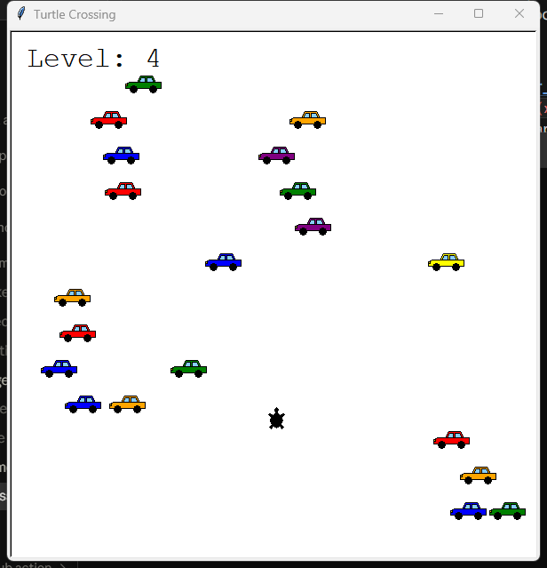
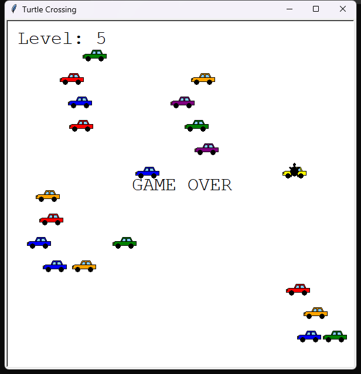

# Turtle Crossing

A Turtle Crossing game, the Day 23 capstone of Udemy's *100 Days of Code: The
Complete Python Pro Bootcamp*. Steer the turtle north across a busy road of
randomly generated cars. Each crossing raises the level and the car speed; one
collision ends the game. Written with the Python standard library only.



## Requirements

- Python 3.13 or newer, with `tkinter` (the `turtle` module needs it).
- `git` to clone the repository.
- `pytest` for the tests (development only; the game has no runtime dependencies).
- Optional: [Doxygen](https://www.doxygen.nl/) to build the source documentation.

## Set up

Clone the repository and create a local virtual environment named `.venv` in
the project folder. Upgrade `pip` first, then install the development
dependencies from `pyproject.toml`.

### Windows powershell

```powershell
git clone https://git.tirsystem.com/Tirsvad-Udemy-100-days-of-code/023-turtle-crossing.git
cd 023-turtle-crossing
py -3.13 -m venv .venv
.\.venv\Scripts\Activate.ps1
python -m pip install --upgrade pip
python -m pip install --group dev
```

If PowerShell refuses to run the activation script, allow it for this session
with `Set-ExecutionPolicy -Scope Process -ExecutionPolicy RemoteSigned`.

### Linux debian

```bash
sudo apt update && sudo apt install -y git python3.13 python3.13-venv python3-tk
git clone https://git.tirsystem.com/Tirsvad-Udemy-100-days-of-code/023-turtle-crossing.git
cd 023-turtle-crossing
python3.13 -m venv .venv
source .venv/bin/activate
python -m pip install --upgrade pip
python -m pip install --group dev
```

If `python3.13` is not in your distribution, install Python 3.13 with your
preferred tool (for example `pyenv`) and run the same `venv` command with it.

### MacOS

```bash
brew install python@3.13 python-tk@3.13 git
git clone https://git.tirsystem.com/Tirsvad-Udemy-100-days-of-code/023-turtle-crossing.git
cd 023-turtle-crossing
python3.13 -m venv .venv
source .venv/bin/activate
python -m pip install --upgrade pip
python -m pip install --group dev
```

## Run

Activate the `.venv`, then start the game from the project root:

```bash
python src/main.py
```

Press the **Up** arrow key to move the turtle forward. Reaching the top edge
returns the turtle to the start and speeds up the cars. A collision shows
`GAME OVER`; click the window to close it.



## Run the tests

With the `.venv` active:

```bash
python -m pytest
```

Tests that need a window are skipped automatically when no display is
available. On a headless Linux machine run `xvfb-run python -m pytest`.

## Continuous integration

`.gitea/workflows/ci.yml` runs on every push to `main` and on every pull
request. It sets up Python 3.13, upgrades `pip`, installs the development
dependencies and runs `pytest` under a virtual display.

## Build the source documentation

The source uses Doxygen comments and the `Doxyfile` in the project root.

```bash
doxygen Doxyfile
```

Open `docs/api/html/index.html` in a browser.

## Project layout

```text
.
├── src/            game source
│   ├── main.py         screen, objects and the game loop
│   ├── constants.py    every constant
│   ├── player.py       Player
│   ├── car_manager.py  CarManager
│   ├── car_shape.py    how a car is drawn
│   ├── collision.py    collision test
│   └── scoreboard.py   Scoreboard
├── tests/          pytest tests
├── docs/           planning and review documents (business case, plan, milestones, reviews)
│   └── images/         screenshots used by the README and the wiki
├── wiki/           wiki pages in English, Danish (-da) and Bahasa Malaysia (-ms)
├── Doxyfile        Doxygen configuration
├── pyproject.toml  project configuration and development dependencies
└── .gitea/         continuous integration workflow
```

All constants live in `src/constants.py`.

## License

GNU Affero General Public License v3.0, see [LICENSE](LICENSE).
