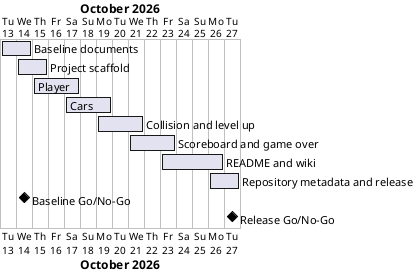

# Project Plan

## Metadata
| Key | Value |
| --- | --- |
| ID | PP-001 |
| CrossReference | [BC-001], [SA-001] |
| Language | en |
| Domain | it |

## Version History
| Date | Status | Author | Reviewer | Change | Commit |
| --- | --- | --- | --- | --- | --- |
| 2026-10-13 | Accepted | Jens Tirsvad Nielsen | AI as stand-in for S01 | Initial version | [93d8321] |

---

## Purpose

Schedule the eight gateways that take the Turtle Crossing project from a
reviewed baseline to a published, documented game, one pull request per
gateway, inside a two-week window.

## Planning Assumptions

- Week 1 starts 2026-10-13; the plan ends by 2026-10-27. S01 gave no deadline,
  so two weeks is an assumption (see Open Issues).
- Each gateway is one branch and one pull request, in the order of the
  course's steps.
- S01 owns and approves every gateway; reviews are not independent.

## Gateway Schedule

| Gateway | Document | Window | Decision date | Owner | Stories | Main deliverable | Milestone |
| --- | --- | --- | --- | --- | --- | --- | --- |
| Baseline documents | [MIL-001] | 10-13 to 10-14 | 2026-10-14 | S01 | none | Accepted planning baseline | |
| Project scaffold | [MIL-002] | 10-14 to 10-15 | 2026-10-15 | S01 | none | Tooling, constants, README, CI | |
| Player | [MIL-003] | 10-15 to 10-17 | 2026-10-17 | S01 | none | Player class and tests | |
| Cars | [MIL-004] | 10-17 to 10-19 | 2026-10-19 | S01 | none | Car manager and car-shaped cars | |
| Collision and level up | [MIL-005] | 10-19 to 10-21 | 2026-10-21 | S01 | none | Collision, finish line, speed-up | |
| Scoreboard and game over | [MIL-006] | 10-21 to 10-23 | 2026-10-23 | S01 | none | Complete playable game | |
| README and wiki | [MIL-007] | 10-23 to 10-26 | 2026-10-26 | S01 | none | README, wiki en/da/ms, Doxygen | |
| Repository metadata and release | [MIL-008] | 10-26 to 10-27 | 2026-10-27 | S01 | none | Description, topics, final review | |



## Scope Coverage

| Business Case scope item | Gateway |
| --- | --- |
| Player, car manager and scoreboard classes, `constants.py`, `main.py` | [MIL-003], [MIL-004], [MIL-005], [MIL-006] |
| Car appearance drawn with the standard `turtle` module | [MIL-004] |
| Unit tests for display-free logic | [MIL-003] to [MIL-006] |
| `pyproject.toml`, `.gitignore`, Doxygen, `Doxyfile` | [MIL-002] |
| README, CI, wiki in en, da, ms | [MIL-002], [MIL-007] |
| Repository description and topics | [MIL-008] |

## Dependencies

```
MIL-001 -> MIL-002 -> MIL-003 -> MIL-004 -> MIL-005 -> MIL-006 -> MIL-007 -> MIL-008
```

A No-Go at a gateway moves every later date by the rework time; the final
date is not guaranteed.

## Plan Risks

| Risk | Impact | Mitigation |
| --- | --- | --- |
| Evening-only availability | Schedule slip | Gateways are small; dates are decision dates, not commitments |
| Wiki translations (da, ms) take longer than code | MIL-007 slips | Write English first; da and ms follow the same page structure |
| Custom car shape needs several iterations | MIL-004 slips | Design the shape first as its own task |

## Open Issues

- Deadline: S01 to confirm or replace the two-week assumption.
- Wiki layout: the example wiki at TirSystem/github-action is behind the git
  host login; page names will follow the `framework/wiki` pattern (`-da`,
  `-ms` suffixes) unless S01 says otherwise.
- Repository name: the remote is `Tirsvad-Udemy-100-days-of-code/023-turtle-crossing`;
  the prompt wrote `Tirsvad-Udemy-100_days_of_code`. Assumed to be the same.
- No QC checklist exists for the Project Plan; it is accepted by S01.

---

[BC-001]: ./business-case.md
[SA-001]: ./stakeholder-analysis.md
[MIL-001]: ./milestones/mil-001-baseline-docs.md
[MIL-002]: ./milestones/mil-002-scaffold.md
[MIL-003]: ./milestones/mil-003-player.md
[MIL-004]: ./milestones/mil-004-cars.md
[MIL-005]: ./milestones/mil-005-collision-levelup.md
[MIL-006]: ./milestones/mil-006-scoreboard.md
[MIL-007]: ./milestones/mil-007-readme-wiki.md
[MIL-008]: ./milestones/mil-008-repo-metadata.md
[93d8321]: https://git.tirsystem.com/Tirsvad-Udemy-100-days-of-code/023-turtle-crossing/commit/93d83217622a6c555dca728fe10c83c35f8ac7e2
