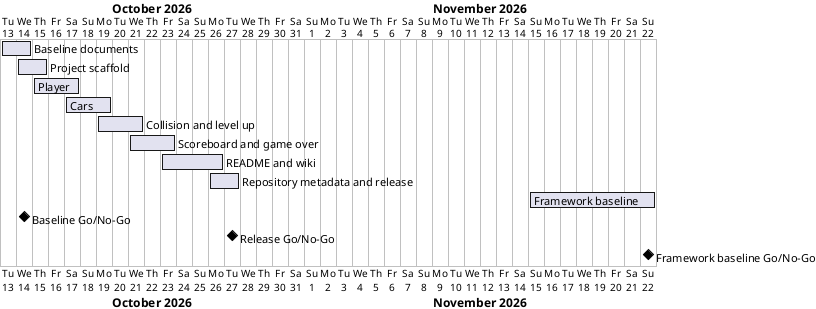

# Project Plan

## Metadata
| Key | Value |
| --- | --- |
| ID | PP-001 |
| CrossReference | [BC-001], [SA-001], [MIL-001], [MIL-002], [MIL-003], [MIL-004], [MIL-005], [MIL-006], [MIL-007], [MIL-008], [MIL-009] |
| Language | en |
| Domain | education |

## Version History
| Date | Status | Author | Reviewer | Change | Commit |
| --- | --- | --- | --- | --- | --- |
| 2026-10-13 | Deprecated | Jens Tirsvad Nielsen | AI as stand-in for S01 | Initial version | [93d8321] |
| 2026-11-15 | Accepted | Jens Tirsvad Nielsen | AI as stand-in for S01 | Added the baseline gateway MIL-009, its schedule row, scope coverage, dependency, risk and Gantt entries and the No-Go rule; updated the open issues about merging and the wiki location; set the domain to education; reviewed in autonomous mode, not independent | [99f5f81] |

---

## Purpose

Schedule the eight gateways that take the Turtle Crossing project from a
reviewed baseline to a published, documented game, one pull request per
gateway, inside a two-week window.

A ninth gateway, [MIL-009], was added on 2026-11-15 to bring the finished project to the baseline of the framework; it runs from 2026-11-15 to 2026-11-22.

## Planning Assumptions

- Week 1 starts 2026-10-13; the plan ends by 2026-10-27. S01 gave no deadline,
  so two weeks is an assumption (see Open Issues).
- Each gateway is one branch and one pull request, in the order of the
  course's steps.
- S01 owns and approves every gateway; reviews are not independent.
- The baseline gateway [MIL-009] starts 2026-11-15 and ends by 2026-11-22, one week (source: [BC-001], Assumptions). The end date of the plan moves from 2026-10-27 to 2026-11-22 because of it; the reason is the agreed minimum quality baseline of the framework.
- For [MIL-009] S01 has authorised the assistant to commit, push, open the pull request and merge it, and the review is done by an AI stand-in for S01 (source: [BC-001], Constraints; [SA-001], Conflicting Interests and Mitigations).

## Gateway Schedule

| Gateway | Document | Window | Decision date | Owner | Stories | Main deliverable | Milestone |
| --- | --- | --- | --- | --- | --- | --- | --- |
| Baseline documents | [MIL-001] | 10-13 to 10-14 | 2026-10-14 | S01 | none | Accepted planning baseline | [Milestone 105](https://git.tirsystem.com/Tirsvad-Udemy-100-days-of-code/023-turtle-crossing/milestone/105) |
| Project scaffold | [MIL-002] | 10-14 to 10-15 | 2026-10-15 | S01 | none | Tooling, constants, README, CI | [Milestone 106](https://git.tirsystem.com/Tirsvad-Udemy-100-days-of-code/023-turtle-crossing/milestone/106) |
| Player | [MIL-003] | 10-15 to 10-17 | 2026-10-17 | S01 | none | Player class and tests | [Milestone 107](https://git.tirsystem.com/Tirsvad-Udemy-100-days-of-code/023-turtle-crossing/milestone/107) |
| Cars | [MIL-004] | 10-17 to 10-19 | 2026-10-19 | S01 | none | Car manager and car-shaped cars | [Milestone 108](https://git.tirsystem.com/Tirsvad-Udemy-100-days-of-code/023-turtle-crossing/milestone/108) |
| Collision and level up | [MIL-005] | 10-19 to 10-21 | 2026-10-21 | S01 | none | Collision, finish line, speed-up | [Milestone 109](https://git.tirsystem.com/Tirsvad-Udemy-100-days-of-code/023-turtle-crossing/milestone/109) |
| Scoreboard and game over | [MIL-006] | 10-21 to 10-23 | 2026-10-23 | S01 | none | Complete playable game | [Milestone 110](https://git.tirsystem.com/Tirsvad-Udemy-100-days-of-code/023-turtle-crossing/milestone/110) |
| README and wiki | [MIL-007] | 10-23 to 10-26 | 2026-10-26 | S01 | none | README, wiki en/da/ms, Doxygen | [Milestone 111](https://git.tirsystem.com/Tirsvad-Udemy-100-days-of-code/023-turtle-crossing/milestone/111) |
| Repository metadata and release | [MIL-008] | 10-26 to 10-27 | 2026-10-27 | S01 | none | Description, topics, final review | [Milestone 112](https://git.tirsystem.com/Tirsvad-Udemy-100-days-of-code/023-turtle-crossing/milestone/112) |
| Framework baseline | [MIL-009] | 11-15 to 11-22 | 2026-11-22 | S01 | none | The framework release, the wiki in `docs/wiki/`, the README in the framework template, the licence metadata and the review records | [Milestone 531](https://git.tirsystem.com/Tirsvad-Udemy-100-days-of-code/023-turtle-crossing/milestone/531) |



## Scope Coverage

| Business Case scope item | Gateway |
| --- | --- |
| Player, car manager and scoreboard classes, `constants.py`, `main.py` | [MIL-003], [MIL-004], [MIL-005], [MIL-006] |
| Car appearance drawn with the standard `turtle` module | [MIL-004] |
| Unit tests for display-free logic | [MIL-003] to [MIL-006] |
| `pyproject.toml`, `.gitignore`, Doxygen, `Doxyfile` | [MIL-002] |
| README, CI, wiki in en, da, ms | [MIL-002], [MIL-007] |
| Repository description and topics | [MIL-008] |
| The baseline milestone: framework release, wiki location, README template, licence metadata, review records | [MIL-009] |

## Dependencies

```
MIL-001 -> MIL-002 -> MIL-003 -> MIL-004 -> MIL-005 -> MIL-006 -> MIL-007 -> MIL-008 -> MIL-009
```

A No-Go at a gateway moves every later date by the rework time; the final
date is not guaranteed. A No-Go on [MIL-009] leaves the game and the earlier gateways as they are; S01 decides the new date.

## Plan Risks

| Risk | Impact | Mitigation |
| --- | --- | --- |
| Evening-only availability | Schedule slip | Gateways are small; dates are decision dates, not commitments |
| Wiki translations (da, ms) take longer than code | MIL-007 slips | Write English first; da and ms follow the same page structure |
| Custom car shape needs several iterations | MIL-004 slips | Design the shape first as its own task |
| A continuous integration (CI) check fails on the pull request of [MIL-009] | The merge is delayed past 2026-11-22 | The failure is fixed on the same branch and the checks run again; after three failed rounds on one cause the work stops and S01 decides (trace: success criterion 8 of [BC-001]) |

## Open Issues

- Deadline: S01 to confirm or replace the two-week assumption.
- Wiki layout: the example wiki at TirSystem/github-action is behind the git
  host login; page names will follow the `framework/wiki` pattern (`-da`,
  `-ms` suffixes) unless S01 says otherwise.
- Repository name: the remote is `Tirsvad-Udemy-100-days-of-code/023-turtle-crossing`;
  the prompt wrote `Tirsvad-Udemy-100_days_of_code`. Assumed to be the same.
- No QC checklist exists for the Project Plan; it is accepted by S01.
- Merging: the pull requests of MIL-001 to MIL-008 are merged; [MIL-009] is merged by the assistant in autonomous mode.
- Wiki: the pages moved from `wiki/` to `docs/wiki/` in [MIL-009], the location the framework requires; the host publishes them from there after the merge and the published wiki is checked then. The older pages named with a space (`Home da`) stay on the host; this project does not delete them.

---

[BC-001]: ./business-case.md
[SA-001]: ./stakeholder-analysis.md
[MIL-001]: ./milestones/mil-001-baseline-docs.md
[MIL-002]: ./milestones/mil-002-scaffold.md
[MIL-003]: ./milestones/mil-003-player.md
[MIL-004]: ./milestones/mil-004-cars.md
[MIL-005]: ./milestones/mil-005-collision-levelup.md
[MIL-006]: ./milestones/mil-006-scoreboard.md
[MIL-007]: ./milestones/mil-007-readme-wiki.md
[MIL-008]: ./milestones/mil-008-repo-metadata.md
[93d8321]: https://git.tirsystem.com/Tirsvad-Udemy-100-days-of-code/023-turtle-crossing/commit/93d83217622a6c555dca728fe10c83c35f8ac7e2
[MIL-009]: ./milestones/mil-009-framework-baseline.md
[99f5f81]: https://git.tirsystem.com/Tirsvad-Udemy-100-days-of-code/023-turtle-crossing/commit/99f5f819127f7d77ea0b6b9fe782e14766de5395
